<h1 align="center">Hi 👋, I'm Rahul Gupta</h1>

<h3 align="center">
  AI/ML Developer | Data Science | Generative AI | Agentic AI
</h3>

  Building intelligent applications with Machine Learning, Deep Learning,
  Generative AI and Agentic AI.

  

 

### 👨‍💻 About Me

### 👨‍💻 About Me

I'm an aspiring **AI/ML Engineer** and third-year B.Tech student specializing in Artificial Intelligence at **ABES Institute of Technology (ABESIT), Ghaziabad (2024–2028)**, passionate about building practical, scalable, and intelligent AI-powered applications.

I enjoy transforming ideas into end-to-end solutions — from data preprocessing, feature engineering and machine learning model development to building LLM-powered applications, intelligent retrieval systems and multi-agent workflows.

**What I work with:**

- 🤖 **Machine Learning & Deep Learning:** Scikit-learn, PyTorch, CNNs, Regression, Classification, Clustering, Feature Engineering and Model Evaluation.
- 👁️ **Computer Vision & NLP:** OpenCV, Haar Cascades, Text Classification, Emotion Detection and Speech-to-Text using Whisper.
- 🧠 **Generative AI & RAG:** LLMs, Prompt Engineering, Retrieval-Augmented Generation, Embeddings, Hugging Face, FAISS and ChromaDB.
- 🔗 **Agentic AI & Automation:** LangChain, LangGraph, AI Agents, Multi-Agent Workflows, Tool Calling, Function Calling, API Integration, Human-in-the-Loop (HITL) and n8n.
- 🚀 **Backend & Deployment:** Python, FastAPI, Streamlit, REST APIs, Webhooks, Docker, Git and GitHub.
- 📊 **Data Analysis & Visualization:** NumPy, Pandas, Matplotlib, Seaborn and Exploratory Data Analysis (EDA).

**Experience & Highlights:**

- Completed an **Artificial Intelligence Internship at Edunet Foundation – IBM SkillsBuild**, gaining hands-on experience in data preprocessing, model training, evaluation and deployment.
- Participated in **Smart India Hackathon**, collaborating with a team to develop solutions under real-world constraints.
- Served as **Campus Ambassador for UDGAM'26, IIT Guwahati**, contributing to student outreach and engagement.
- Worked as a **Core Member of Prayaas – Electoral Literacy Club**, contributing to awareness and outreach initiatives.
- Built end-to-end AI applications involving RAG-based document assistants, multi-agent research workflows, video intelligence and predictive analytics.

🌱 **Currently Exploring:** Natural Language Processing, advanced Generative AI applications, LLM architectures and Agentic AI systems.

🎯 **Currently Looking For:** Internship and entry-level opportunities in AI/ML Engineering, Machine Learning, Data Science, Generative AI and Agentic AI.

💡 I believe in learning by building, solving real-world problems and continuously improving through hands-on development.

 

---
## 🛠️ Tech Stack & Tools

### 💻 Programming Languages & Database

  

### 🤖 Machine Learning & Deep Learning

  

### 👁️ Computer Vision & Natural Language Processing

  
  
  
  
  

### 🧠 Generative AI, LLMs & RAG

  
  
  
  
  
  
  
  

### 🔗 Agentic AI & Automation

  
  
  
  
  
  

### 📊 Data Analysis & Visualization

  
  
  
  

### ⚙️ Backend, APIs & Deployment

  
  
  

### 🔧 Developer & Research Tools

  
  
  
  
  
  
  
  

